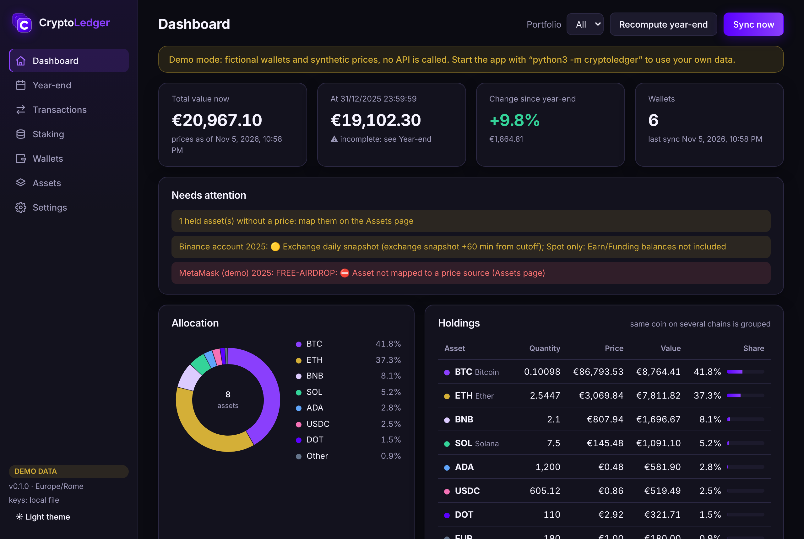

# CryptoLedger

A local app for tracking your **own** crypto addresses and exchange accounts in one dashboard,
with every value in **EUR** at the rate of its time and balances taken at **23:59:59 of each
fiscal year** (31/12, Europe/Rome by default).

It runs on your computer and opens in your browser. Your addresses, API keys and ledger never
leave your machine: only public addresses are sent to block explorers, and only to read them.



- **Settings page for your addresses**: pick the network, paste the address, done. One EVM
  address can be tracked on several chains at once. Exchange accounts use a read-only API key.
- **One free key to start**: an [Alchemy](https://dashboard.alchemy.com/signup) key reads every
  EVM chain (Ethereum, Polygon, Arbitrum, Optimism, Base, Avalanche, Linea, BNB Smart Chain, Monad,
  Arc, Ronin) and Solana. Bitcoin, Stellar, Terra, Terra Classic, Tron and Solar (SXP) work with
  no key at all. An optional Etherscan key gives the most complete history on Ethereum, Polygon,
  Arbitrum and Linea; optional Helius and TronGrid keys make Solana and Tron faster. Binance
  accounts (with Simple Earn rewards) use a read-only key; manual accounts cover anything else.
- **API call limits you control**: calls per second or per minute, and per day, for each service, so a free plan
  is never exceeded (Settings → API providers and Price sources).
- **Providers and networks you control**: add an API provider (any Etherscan-compatible,
  Alchemy-compatible, Cosmos SDK LCD, Esplora or Horizon service) or a new blockchain from Settings,
  with its key, limits and Test, and choose which provider reads each chain. No code.
- **Year-end balances at 23:59:59** from the best available source (snapshot, chain state,
  full transaction history), cross-checked, with every value traced to its source.
- **EUR at the time**: Binance public 1-minute prices (no key, full history), CoinGecko,
  CoinMarketCap; USD prices converted with the official **ECB reference rate** of that day.
- **Exports kept up to date**: `balances_YYYY-12-31.csv` (every wallet × asset at 31/12),
  `transactions_YYYY.csv` (one row per transaction, EUR at its time) and `wallets.csv`.
- **Year-end report** per fiscal year: initial/final values, days held, IC estimate
  (Italian RW quadro) and an evidence file.
- **Easy to extend**: a new EVM chain is a form in Settings; a new blockchain or exchange API is
  one Python class (see [docs/ADDING_AN_ADAPTER.md](docs/ADDING_AN_ADAPTER.md)).

> CryptoLedger is a record-keeping tool, not tax advice. Check flagged values (⛔ / 🟡) and
> confirm your tax treatment with a professional.

## Quick start

You need **Python 3.9 or newer** (already on macOS; on Windows get it from python.org). Nothing
else is required.

```bash
git clone https://github.com/occhinog/cryptoledger.git
```

```bash
cd cryptoledger
```

```bash
python3 -m cryptoledger
```

The app opens at <http://127.0.0.1:8765>. On Windows use `py -m cryptoledger`, or double-click
`start.bat` (macOS: `start.command`).

Then get **one free key**: sign up at [dashboard.alchemy.com](https://dashboard.alchemy.com/signup)
(e-mail or Google), create an app, enable the chains you use (Mainnet), copy the API key and paste
it in **Settings → API providers → Alchemy** → **Save** → **Test**. That reads every EVM chain and
Solana; Bitcoin, Stellar, Terra, Tron and Solar need no key. Add your addresses on the
**Wallets** page and press **Sync now**.

Want to look around first? `python3 -m cryptoledger demo` starts with fictional wallets and
synthetic prices, fully offline, in a separate `demo-data/` folder.

### Optional extras

```bash
python3 -m pip install -r requirements-optional.txt
```

| Package | Why |
|---|---|
| `keyring` | Stores API keys in the macOS Keychain / Windows Credential Locker instead of `data/secrets.json` |
| `certifi` | Fixes "certificate verify failed" on python.org builds of Python for macOS |
| `tzdata` | Needed on Windows only, for time zones |

## Set up your data

1. **Wallets** → choose the network, paste the address, give it a label. For an EVM address,
   tick the other chains where you use it. Optional fields:
   - **Portfolio / owner** groups wallets (yours, a family member's, a client's); the dashboard filters by it.
   - **RW slot** fixes the row order in the Italian RW form.
   - **Platform**: where the wallet is held (wallet app, device or exchange). The list starts
     empty: each new name you type is saved and offered for the next wallets.
   - **Bollo already applied**: tick it for accounts at an Italian intermediary, so no IC is estimated.
2. **Settings** has three boxes for the services the app calls. Each provider row takes the key
   (if any), the plan's **speed limit** (per second or per minute, as your provider states it)
   and **calls per day** (defaults are conservative free-plan values; empty = no limit). The app
   spaces its calls, shows the calls used today, and stops calling a service once its daily cap is
   reached, until 00:00 UTC. **Test** makes one cheap call to check the service and your key,
   and says what it cost.

   **API providers** (where your wallets are read). Built in:

   | Provider | Reads | Free? |
   |---|---|---|
   | Alchemy (**the one key you need**) | Every EVM chain: Ethereum, Polygon, Arbitrum, Optimism, Base, Avalanche, Linea, BNB Smart Chain, Monad, Arc, Ronin; and Solana | Yes, [dashboard.alchemy.com](https://dashboard.alchemy.com/signup), sign-up with e-mail or Google; enable each chain on your Alchemy app |
   | Etherscan (optional) | Ethereum, Polygon, Arbitrum, Linea, with the most complete history (internal transfers on every chain, failed transactions). Used there automatically once its key is saved | Yes, [etherscan.io/myapikey](https://etherscan.io/myapikey); other chains need a paid plan |
   | Solana (Helius) (optional) | Solana, faster; without it Solana is read with your Alchemy key, or the slow public endpoint | Yes, [dashboard.helius.dev](https://dashboard.helius.dev/) |
   | Tron (TronGrid) | Tron (TRX and TRC-20 tokens such as USDT) | Yes, [trongrid.io](https://www.trongrid.io/) |
   | mempool.space | Bitcoin | no key |
   | Stellar Horizon | Stellar (XLM and issued assets such as Circle's USDC) | no key |
   | Terra / Terra Classic (PublicNode) | Terra (LUNA) and Terra Classic (LUNC, USTC), staking included | no key |

   The Solar API appears once a wallet uses it. Binance account
   keys (read-only) are entered per account on the Wallets page. **+ Add provider** adds any
   other service that speaks a supported type — Etherscan-compatible (Blockscout, Routescan,
   Lineascan…), Alchemy-compatible, Cosmos SDK LCD, Esplora or Horizon — with its key, limits and Test.
   No code, no request to anyone.

   **Networks**: every blockchain you can track and the provider that reads it. Ethereum,
   Polygon, Arbitrum and Linea are on **Automatic**: Etherscan if you saved its key, otherwise
   Alchemy (Optimism, Base and Avalanche: Alchemy first). Choose a provider to fix it, give its
   Alchemy name, hide the chains you
   do not use from the Wallets list, set an optional archive node URL (lets the app read each
   balance directly at the 31/12 block), or **+ Add network** for a new chain (chain id, native
   coin, price ids, explorer links). See [docs/ADDING_AN_ADAPTER.md](docs/ADDING_AN_ADAPTER.md).

   **Price sources** (market prices, they never read your wallets): Binance public prices and
   ECB rates (no key), CoinGecko (optional key; Demo covers the last 365 days) and
   CoinMarketCap (optional key; free plan has current prices only), plus the order in which
   they are used and how USD prices become EUR.

   Solar (SXP) is winding down and its public API may move: if syncs fail, add a provider with
   the current URL.
3. Press **Sync now**. The first sync reads the whole history and can take a few minutes;
   later syncs only read what is new.
4. Press **Recompute year-end** (top bar) to compute balances and EUR values at every
   fiscal-year end. This never happens by itself: after a sync, a manual entry, a price mapping
   or a settings change the button lights up and the Year-end page says the values are out of
   date, until you press it. Recomputing also rewrites the exports.
5. **Assets**: tokens the app does not know are listed here. Map them to a CoinGecko id or a
   Binance ticker, or mark them as spam (airdropped scam tokens are common: ignored everywhere).
   Mark real tokens that can no longer be traded (delisted, dead projects) as **ghost**: they stay
   in your balances and the RW, valued at the price they had while they traded (or their live
   price if a market still exists) and at €0 once there is no market, without the ⛔ "no price"
   flag; they have their own **Ghost** tab and are left off the Dashboard, like spam. **Clear all**
   empties the list (your mappings and spam marks too; wallets, transactions and year-end values
   stay); **Load all** reads the tokens each wallet holds now, without the transactions (a few
   calls per wallet instead of one per transaction); assets moved in the past are rebuilt from
   the history already stored. Use **Sync now** for new transactions.
6. **Year-end**: check each wallet's balance source and flags, enter manual balances where an
   API cannot help, then download the report.
7. **Transactions**: a compact list, one line per movement. Hover the time for the seconds, the
   wallet for its network and the tx link for the full hash and the counterparty. Change the
   category in place. Spam is hidden by default: choose **All, spam included** or **spam** in
   the category filter to see it.
8. **Staking**: your staking positions and the rewards of each fiscal year (see below).

### Staking

Staked coins are still yours: they belong in the RW and the IC at their year-end value, and
rewards are income at their EUR value on the day received (which becomes their cost).

**What is automatic**: Binance Simple Earn positions (listed on the Staking page from the
account's live balances) and their rewards (imported by each sync); on-chain movements you set
to `reward`. **What is manual**: staking without an API (Ledger Live, other exchanges) and native
staking whose rewards arrive without a transaction (Solana stake accounts, rebasing tokens such
as stETH): there you enter the year-end balance, and rewards if you want them listed.

- **Positions**: any wallet can be marked **Staking position** (Wallets → Edit). For staking
  without an API (inside Ledger Live, an exchange Earn product…) press **+ Add position** on the
  Staking page: it creates a manual account; then **Enter balance** at each year-end. For an
  on-chain stake account (e.g. a Solana stake account) add its address as a wallet and tick
  Staking position. Positions are valued at the cutoff like every wallet, so they are already in
  the year-end balances, the RW and the IC.
- **Rewards**: every movement with the category `reward`, per fiscal year, with quantity and EUR
  value on receipt, totals per asset. **Binance Simple Earn** rewards (flexible and locked) are
  imported automatically by each sync of a Binance account (history from December 2022, the
  start of Simple Earn). On-chain rewards come from the synced history (set the category on the
  Transactions page; **Open in Transactions** lists them). Rewards credited
  without a transaction can be typed on manual accounts (date, asset, quantity): they are
  valued in EUR at that moment and appear in `transactions_YYYY.csv` with type `reward`.
  Typed rewards do not change a manual balance: keep entering the year-end quantity.

### Start over

Settings → **Reset** deletes everything: wallets, transactions, assets, prices, year-end values,
settings, API keys (keychain and `data/secrets.json`), call counters, exports and reports. A
window lists what goes and shows a random sentence; **Delete everything** is enabled only once
you type that sentence exactly. Keys set as `CRYPTOLEDGER_…` environment variables cannot be
removed by the app: unset them yourself. Back up `data/` first if you may need it.

### Solana with Helius

Solana is read with your **Alchemy** key if you saved one (enable Solana on your Alchemy app).
Helius is an optional, faster alternative with its own free key; it is used first when saved.
With neither key Solana is read from the public Solana endpoint, which works but is slow and
rate-limited.

1. **Get a key.** Sign up at [dashboard.helius.dev](https://dashboard.helius.dev/) (free plan)
   and copy the API key shown on the dashboard.
2. **Add it to the app.** Settings → API providers → **Solana (Helius)** row → paste the key →
   **Save** → **Test**. Test reads the current Solana slot and costs 1 credit.
3. **Set your plan's limits** in the same row: the free plan allows 10 calls **per second** (the
   default). Its credits are monthly: if you want a daily cap, divide them by 30.
4. **Add your Solana wallets and sync.** Wallets → network **Solana** → paste the address →
   **Add wallet** → **Sync now** → **Recompute year-end**.
5. **Check the first sync.** Compare the SOL and token balances on the Dashboard with the
   wallet's page on [explorer.solana.com](https://explorer.solana.com).

Good to know:

- A sync lists the wallet's transactions (1,000 per call) and then reads each new transaction
  once (one call each), plus a few calls for the live balances. The first sync of a busy wallet
  therefore takes one call per transaction; later syncs only read what is new.
- The SOL balance after each transaction comes from the chain itself, so year-end SOL balances
  are exact, not a sum.
- *"Helius refused the API key (401)"*: the key is wrong or was revoked. Copy it again from the
  Helius dashboard and press **Test**.

### Every EVM chain with Alchemy

One free **Alchemy** key (sign-up with e-mail or Google) reads Ethereum, Polygon, Arbitrum,
Optimism, Base, Avalanche, Linea, BNB Smart Chain, Monad, Arc and Ronin. (The BscScan API closed in
December 2025, and Etherscan's free plan does not cover BNB Smart Chain, Base, Optimism,
Avalanche or Arc.)

1. Sign up at [dashboard.alchemy.com](https://dashboard.alchemy.com/signup) and create an app;
   enable the chains you use (Mainnet) on it, Solana too if you have a Solana wallet; copy the API key.
2. **Settings → API providers → Alchemy**: paste the key, **Save keys and limits**, **Test**.
3. Add your 0x address on the **Wallets** page (tick every chain where you use it) and **Sync now**.

The app reads native and token transfers (`alchemy_getAssetTransfers`), the gas of the
transactions you sent, and lists every token held now (`alchemy_getTokenBalances`, also used by
Assets → **Load all**). Alchemy gives internal transfers only on some chains (Ethereum, Polygon,
Base, Arc): elsewhere, a coin received from a contract (e.g. a DEX refund) is caught by the year-end
check against chain state and flagged ⛔. Failed transactions are not listed, so their gas is
missing. For the most complete history on Ethereum, Polygon, Arbitrum and Linea, also save a free
**Etherscan** key: those chains switch to it automatically (Settings → Networks shows
"Automatic: Etherscan"), and the next sync continues from the last block read, so nothing is
counted twice. The Alchemy name of each chain (bnb-mainnet,
monad-mainnet, arc-mainnet…) is in Settings → Networks; if **Test** reports an error for a chain,
check the name in your Alchemy dashboard and correct it there. On Arc the gas coin is USDC: its
ERC-20 mirror (`0x3600…0000`) is ignored so it is not counted twice.

### Terra and Terra Classic

Terra (LUNA) and Terra Classic (LUNC, USTC) are read from PublicNode's public APIs, no key: add
your `terra1…` address on the Wallets page (the same address works on both chains: add it once
per chain). The live balance includes staked and unbonding coins (still yours); staking rewards
are imported as `reward` (Staking page). Public nodes keep only recent transactions, so the
year-end balance of these chains comes from the balance read at each sync, a snapshot near the
cutoff, or a manual entry (Year-end → Enter manually), never from a partial history. Terra
Classic's old fiat stablecoins (KRTC, EUTC… the dust left by staking rewards) are ghost assets
valued at €0. Other Cosmos SDK chains (Cosmos Hub, Osmosis…) can be added from Settings: a
"Cosmos SDK LCD" provider and a network with its address prefix and native denom.

### Stellar

Stellar is read from the public Horizon server, no key: add your G… address on the Wallets page
and **Sync now**. XLM and issued assets are imported (an issued asset is identified by its issuer,
so a fake "USDC" is not priced as Circle's). Liquidity-pool deposits, claimable balances and
account merges are not imported yet: the sync warns when it meets one; check that balance with a
snapshot or a manual entry.

### Tron with TronGrid

TronGrid is the public Tron API run by the TRON network; its key is free.

1. Sign up at [trongrid.io](https://www.trongrid.io/) (email, no card) and open the dashboard.
2. Create an API key and copy it.
3. In CryptoLedger: **Settings → API providers → Tron (TronGrid)**, paste the key, **Save**,
   then **Test**.
4. Add your Tron address (starts with `T`) on the **Wallets** page and press **Sync now**.

Free plan: about 15 calls per second and 100,000 per day (the defaults in the row; the
dashboard shows your account's real limits). Without a key TronGrid may slow down or refuse
calls. The key is sent in the `TRON-PRO-API-KEY` header; if you restrict it in the TronGrid
dashboard, do not limit it by Origin (CryptoLedger calls from your computer, not a website).

## How year-end values are computed

The cutoff for fiscal year *Y* is 23:59:59 local time on the last day of *Y* (Settings → Fiscal
year). For each wallet, the balance at the cutoff comes from the best source available:

1. a **manual entry** for that cutoff;
2. a **live snapshot** taken within 5 minutes of the cutoff (see below);
3. **chain state** at the cutoff block, if you set an archive RPC URL (EVM);
4. the **full transaction history** summed up to the cutoff (exact for Bitcoin; Solana SOL uses
   the balance the chain reports after each transaction);
5. an **exchange daily snapshot** (Binance takes one at 23:59:59 UTC, kept for 30 days: sync in January).

When two sources exist they are compared and differences are flagged ⛔. Each asset is then
priced at the cutoff: Binance 1-minute close (`ETHEUR`, or `SOLUSDT` × ECB USD/EUR of that
day), else CoinGecko, else CoinMarketCap. Details: [docs/METHODOLOGY.md](docs/METHODOLOGY.md).

### Snapshots at the cutoff

While the app is running it snapshots every wallet about a minute before and after each cutoff.
To do it even when the app is closed, schedule `python3 -m cryptoledger snapshot`:

- **macOS**: edit and load [scripts/launchd/com.cryptoledger.snapshot.plist](scripts/launchd/com.cryptoledger.snapshot.plist):

  ```bash
  cp scripts/launchd/com.cryptoledger.snapshot.plist ~/Library/LaunchAgents/
  ```

  ```bash
  launchctl load ~/Library/LaunchAgents/com.cryptoledger.snapshot.plist
  ```

  The Mac must be awake at 23:59 on 31 December.
- **Linux** (cron uses the system time zone):

  ```bash
  (crontab -l; echo "59 23 31 12 * cd $PWD && python3 -m cryptoledger snapshot") | crontab -
  ```

- **Windows** (from the cryptoledger folder, in Command Prompt):

  ```bash
  schtasks /Create /TN CryptoLedgerSnapshot /SC MONTHLY /MO 12 /D 31 /SD 12/31/2026 /ST 23:59 /TR "py -m cryptoledger --data-dir %CD%\data snapshot"
  ```

## Exports

Kept in `data/exports/`. `wallets.csv` and `transactions_YYYY.csv` are rewritten after every
sync and when you edit wallets or categories; `balances_YYYY-12-31.csv` when you press
**Recompute year-end** and right after each 31/12 cutoff (unchanged files are not touched). Download them from the Year-end, Transactions and Wallets pages, or run
`python3 -m cryptoledger export`.

| File | When | One row per | Columns |
|---|---|---|---|
| `balances_YYYY-12-31.csv` | every fiscal year, at 31/12 23:59:59 | wallet × asset | wallet, network, asset, quantity, price_eur, value_eur, price_source |
| `transactions_YYYY.csv` | every fiscal year | transaction | datetime, wallet, network, tx_hash, type, asset_in, qty_in, asset_out, qty_out, fee_asset, fee_qty, value_eur, from_address, to_address |
| `wallets.csv` | whenever your wallets change | wallet | wallet, network, address, platform |

`type` is one of `buy`, `sell`, `swap`, `transfer_in`, `transfer_out`, `reward`, `airdrop`, `fee`,
taken from the transaction's category (editable on the Transactions page). `value_eur` is the
value at the moment of the transaction. Details: [docs/REPORT_CONTRACT.md](docs/REPORT_CONTRACT.md).

## Reports

Year-end → **Write report folder** (or `python3 -m cryptoledger report 2025`) creates
`data/reports/crypto_report_TY2025/`:

| File | Content |
|---|---|
| `rw_crypto.csv` | One row per wallet held in the year: RW slot, initial value (col. 7), final value (col. 8), days held, bollo flag, IC estimate, notes |
| `year_end_balances.csv` | Every asset at the opening and closing cutoff: quantity, EUR price, price source and quote time, balance source, flags |
| `transactions.csv` | Every movement of the year with its category and EUR value at its own time |
| `evidence.md` | Sources, prices used, last data pulls and open flags, for your records |

The format is described in [docs/REPORT_CONTRACT.md](docs/REPORT_CONTRACT.md).

## Look and brand

Dark-first design in the CryptoLedger brand (Night, purples, gold; Inter), with a light theme
from the sidebar. The whole look lives in `web/brand.css` (colours, font, radii), `web/logo.svg`
and the favicon files: to make it your own, follow [docs/BRAND.md](docs/BRAND.md), which also
holds the brand guideline. No code change is needed.

## Privacy and security

- Everything personal lives in `data/` (git-ignored): the SQLite ledger, `secrets.json` if no
  keychain is available, and reports. Back it up; Settings → Reset (or deleting it) starts over.
- The server listens on `127.0.0.1` only, rejects foreign `Host` headers and requires a custom
  header on every change, so other websites cannot drive it.
- API keys are never sent to the browser. Use read-only exchange keys.

## Command line

```bash
python3 -m cryptoledger --help
```

`serve` (default), `sync [--wallet ID] [--full]`, `snapshot`, `report YEAR`, `demo`, and
`--data-dir PATH` to keep the data elsewhere (an encrypted volume, for example).

## Not done yet

- Tax computation (capital gains with weighted-average cost, RT quadro): the ledger and the
  categories are ready for it.
- Binance trades/Convert import (balances come from snapshots meanwhile); rewards of ETH and
  SOL staking (WBETH, BNSOL) accrue in the token's rate, so they are not imported as rewards.
- Bitcoin xpub wallets, DeFi positions, NFTs, rebasing tokens (use snapshots or manual entries).

## Development

```bash
python3 -m unittest discover -s tests
```

No dependencies, no build step: Python standard library on the server, plain JavaScript in
`web/`. Contribution notes for humans and coding agents: [AGENTS.md](AGENTS.md); look and brand
rules: [docs/BRAND.md](docs/BRAND.md).
